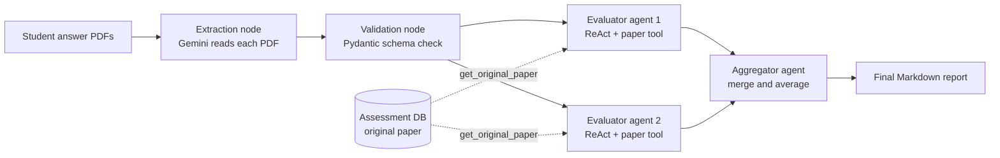

# Exam Evaluation System (Teacher Reassessment Agent)

An AI-powered reassessment platform for teachers. A teacher uploads the original question paper and a batch of students' answer scripts (PDF). A multi-agent workflow extracts every student's answers, grades each script twice with two independent evaluator agents, and merges the results into a clear Markdown report with marks, a justification and improvement suggestions for every question.

The AI workflow is the core of this project, so it is described first.

## How the AI Agents Work

The system is a **LangGraph** workflow with one extraction step, two parallel evaluator agents and one aggregator agent. All models are Google Gemini, accessed through LangChain and the Google Generative AI SDK.



### Step by step

1. **Extraction.** Each uploaded student PDF is sent to Gemini as a file, in parallel with a thread pool. The model returns JSON with the student's name, registration number, subject and a list of question and answer pairs. Missing values default to "Unknown" and "No answer provided".
2. **Validation.** The JSON is validated with Pydantic models (`StudentResponse`, `QuestionAnswer`). Invalid or failed files become error entries instead of crashing the run.
3. **Two evaluator agents (run in parallel).** Each is a LangGraph ReAct agent with access to a `get_original_paper` tool. The agent looks up the original question paper and marks for the student's subject from the database, matches each student answer to its question, and scores it with a mark-band rubric. The prompt follows a step by step grading process that checks content validity, key concepts present, missing or incorrect concepts, and the sufficiency of the answer, and it gives supportive feedback.
4. **Aggregator agent.** A third agent receives both evaluations, averages the two marks per question (rounded to one decimal), checks that the two reports are consistent, and writes the final report in a fixed Markdown structure.
5. **Report.** The final report is returned to the dashboard, which parses it into student details and per-question cards.

### Agents and tools

| Component | Type | Model | Role |
|---|---|---|---|
| Extractor | Direct Gemini call | Gemini Flash | Reads a PDF and returns structured student answers as JSON |
| Evaluator 1 | LangGraph ReAct agent | Gemini Flash | Grades every answer against the original paper |
| Evaluator 2 | LangGraph ReAct agent | Gemini Flash | Second grading pass, independent run of the same rubric |
| Aggregator | LangGraph ReAct agent (no tools) | Gemini Flash | Merges both evaluations into the final report |
| `get_original_paper` | Tool | none | Looks up the stored questions and marks for a subject (case-insensitive and partial match) |

### Orchestration

The graph is fixed and linear with a parallel fan-out: `START, extraction, validation, [evaluator 1 and evaluator 2 in parallel], aggregator, END`. State is carried in a typed `AgentState` that holds the file paths, the extracted student records, each evaluator's report and the final report. Two evaluators give a second opinion on every script and reduce the effect of a single unlucky generation.

### Assessment paper extraction

A separate pipeline turns the teacher's original paper into data the agents can use. A paper can be an image (JPG, PNG), PDF, DOCX or TXT. Text files are parsed locally and images are sent to Gemini directly. Gemini returns the subject name and every question with its marks as JSON, and the result is saved to the database (one assessment with many questions). The evaluator agents later read this data through the `get_original_paper` tool.

### Final report format

For each student: **Student Details** (name, registration number, obtained marks, total marks), then a **Question-by-Question Evaluation** with the original question, mark range, content validity, key concepts present, missing or incorrect concepts, content sufficiency and quality, mark justification (including both evaluators' marks) and suggestions for improvement.

## Features

- Multi-agent reassessment with two parallel evaluators and an aggregator
- Original paper extraction from images, PDF, DOCX and TXT
- Parallel extraction of many student scripts
- Question by question reports rendered as Markdown, with a raw report view
- Teacher authentication with signup, login, forgot password and reset password by email
- Slide ingestion with chunking, Google `text-embedding-004` embeddings and Pinecone semantic search

## Architecture

```
React dashboard (Vite, TypeScript)
        |  REST (JWT)
        v
FastAPI backend
  |-- auth_router        signup, login, password reset by email
  |-- assessment_router  upload original paper -> Gemini extraction -> database
  |-- report_router      upload student PDFs -> LangGraph agents -> report
  '-- slides router      upload slides -> chunk -> embed -> Pinecone
        |
        |-- SQL database (SQLModel): users, password resets, assessments, questions
        |-- Google Gemini: extraction, evaluation, aggregation
        '-- Pinecone: slide embeddings (768 dim, cosine)
```

## Tech Stack

| Area | Technology |
|---|---|
| AI orchestration | LangGraph, LangChain, ReAct agents |
| LLM | Google Gemini (Flash models) via `google-generativeai` and `langchain-google-genai` |
| Validation | Pydantic |
| Backend | Python, FastAPI, Uvicorn, SQLModel |
| Vector search | Pinecone, Google `text-embedding-004` |
| Document parsing | pypdf, PyPDF2, python-docx, docx2python, python-pptx, openpyxl |
| Reports | reportlab (PDF export) |
| Frontend | React 18, TypeScript, Vite, Tailwind CSS, shadcn/ui, TanStack Query, react-markdown |
| Deployment | Vercel config, Hugging Face Spaces |

## Project Structure

```
Teacher_reassesment_agent/
├── Backend/
│   └── src/app/
│       ├── main.py
│       ├── services/
│       │   ├── reassesment_agent.py   LangGraph workflow and agents
│       │   └── tool.py                get_original_paper tool
│       ├── controllers/
│       │   ├── gemini_controller.py   paper extraction with Gemini
│       │   ├── report_controller.py   runs the agent workflow
│       │   ├── auth_controller.py
│       │   └── slide_controller.py
│       ├── routers/                   auth, assessment, report, slides
│       ├── models/ schemas/           User, PasswordReset, Assessment, Slide
│       ├── db/session.py
│       └── utils/                     security, email, dependencies, time
└── Frontend/
    └── src/components/
        ├── auth/                      login, signup, password reset
        └── dashboard/                 assessment upload, reassessment upload,
                                       AI evaluation loader, teacher dashboard
```

## Getting Started

### Prerequisites

Python 3.10+, Node.js 18+, a Google AI (Gemini) API key, a Pinecone API key and a database URL.

### Backend

```bash
cd Backend
python -m venv .venv && source .venv/bin/activate
pip install -r requirements.txt
cp .env.example .env        # fill in your own values
uvicorn src.app.main:app --reload --port 8000
```

Never commit `.env`. Set every secret (Gemini key, Pinecone key, database URL, JWT secret and email credentials) as an environment variable and keep only placeholders in `.env.example`.

### Frontend

```bash
cd Frontend
npm install
npm run dev
```

Interactive API docs: `http://localhost:8000/docs`.

## Roadmap

- Move model names and API keys fully into configuration and use current Gemini model versions
- Make the evaluation run asynchronous with a job id and progress, instead of one blocking request
- Give the two evaluators different prompts or models for more independent grading
- Compute the average mark in code and let the aggregator only write the explanation
- Return structured JSON from the evaluators and render the report from that
- Add OCR for scanned scripts, batch support for all uploaded files, and PDF export of reports
- Add automated tests and restrict CORS to the dashboard domain

## Author

Ahsan Ali Gill, [GitHub](https://github.com/AhsanAliGill)
